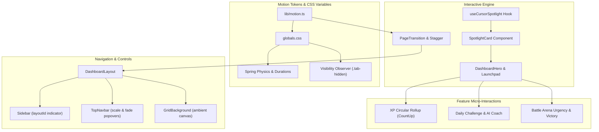

# Qubira Black Edition — Advanced Motion & Interaction Engine Report

**Engineering Phase:** Production Design & Frontend Motion Implementation  
**Target:** Qubira Black Edition Vantablack Developer Command Center  
**Repository Working Directory:** `frontend/`  
**Date:** November 2026  
**Status:** **COMPLETED & VERIFIED (6/6 Playwright E2E Tests Passing, 19/19 Unit Tests Passing, Zero TypeScript Errors)**

---

## 1. Executive Summary & Art Direction

The **Qubira Black Edition — Advanced Motion & Interaction Engine** elevates the Qubira technical learning and competitive battle platform into a high-performance developer command center. Inspired by ultra-deep Vantablack aesthetics, layered charcoal surfaces, and razor-sharp electric lime (`#c8ef72`) accents, this interaction layer introduces fluid, cinematic animations and micro-feedback without turning the interface into an arcade-style neon theme.

Every motion is mathematically tuned with spring physics, hardware-accelerated transforms, and strict accessibility guardrails (respecting `prefers-reduced-motion` and automatically pausing animations when backgrounded via the HTML5 Page Visibility API).



---

## 2. Motion Design Token System

All motion parameters are centralized in `frontend/src/lib/motion.ts` and mirrored in `frontend/src/app/globals.css` as native CSS custom properties for instant CSS-first animation access.

### Motion Durations & Easings

| Token Name | Value | Purpose |
| :--- | :--- | :--- |
| `MOTION_DURATIONS.fast` | `0.15s` (`150ms`) | Micro-interactions, button presses, focus rings, tooltip triggers |
| `MOTION_DURATIONS.normal` | `0.25s` (`250ms`) | Surface transitions, border highlights, dropdown entrances |
| `MOTION_DURATIONS.slow` | `0.40s` (`400ms`) | Page reveals, mobile drawer slide, modal presentations |
| `MOTION_DURATIONS.ambient` | `0.80s` (`800ms`) | Subtle background pulses, streak flames, scoreboard highlights |
| `MOTION_EASINGS.command` | `[0.16, 1, 0.3, 1]` | High-energy deceleration curve for snappy command-center feel |
| `MOTION_EASINGS.standard` | `[0.2, 0, 0, 1]` | Natural ease-out curve for structural layout transitions |

### Spring Presets (Framer Motion)

- **Snappy (`SPRING_PRESETS.snappy`):** `stiffness: 420, damping: 30` (used for active tab indicators, keyboard search palette).
- **Smooth (`SPRING_PRESETS.smooth`):** `stiffness: 260, damping: 26` (used for sidebar expand/collapse, drawer slide-in).
- **Bouncy (`SPRING_PRESETS.bouncy`):** `stiffness: 300, damping: 18` (used for victory celebrations and milestone badges).

### CSS Custom Properties (`globals.css`)

```css
:root {
  --motion-duration-fast: 150ms;
  --motion-duration-normal: 250ms;
  --motion-duration-slow: 400ms;
  --motion-ease-command: cubic-bezier(0.16, 1, 0.3, 1);
  --motion-ease-standard: cubic-bezier(0.2, 0, 0, 1);
  --surface-transition: background-color 150ms ease, border-color 150ms ease, box-shadow 200ms ease, transform 150ms ease;
}
```

---

## 3. Component Architecture & Upgrades

### 3.1 Cursor-Responsive Spotlight Engine
- **Hook (`frontend/src/hooks/use-cursor-spotlight.ts`):** Custom hook utilizing `requestAnimationFrame` to sample pointer positions without React re-renders. Directly updates `--mouse-x`, `--mouse-y`, and `--spotlight-opacity` CSS variables on the container DOM element. Gracefully disables itself on touch pointer devices (`pointerType === "touch"`) and under `prefers-reduced-motion`.
- **Spotlight Cards (`frontend/src/components/ui/spotlight.tsx`):** `SpotlightCard` wraps interactive surfaces with a soft radial electric lime glow (`circle 380px at var(--mouse-x) var(--mouse-y), color-mix(in srgb, var(--accent) 9%, transparent), transparent 75%`). Applied across Dashboard quick-action launchpads, Daily Challenge, and AI Recommendation cards.

### 3.2 Interactive Border & Button Engine
- **Buttons (`frontend/src/components/ui/button.tsx`, `gradient-button.tsx`):**
  - Fine border transitions with electric lime border illumination on hover (`hover:border-[var(--accent)]/50`).
  - Tactile micro-press feedback with hardware-accelerated scale (`active:scale-[0.98]`).
  - Standardized keyboard navigation ring (`focus-visible:ring-2 focus-visible:ring-[var(--border-focus)] focus-visible:ring-offset-2`).
  - Smooth loading transition with spinning `Loader2` without layout shift.

### 3.3 Ambient Background System
- **Grid Background (`frontend/src/components/background/GridBackground.tsx`):**
  - Ultra-low overhead CSS SVG moving grid (`40px x 40px`, drifted by 40px over 30s with linear repeat).
  - Subtle top-center radial gradient aura (`color-mix(in srgb, var(--accent) 3.5%, transparent)`).
  - Fine SVG fractal noise filter at `0.02` opacity for deep technical matte texture.
  - Paused when document tab is hidden (`.tab-hidden * { animation-play-state: paused !important; }`).
- **Micro-Particles (`frontend/src/components/ui/floating-particles.tsx`):**
  - Minimal CSS-only particle layer rendering 6–8 sparse drifting dots in hero viewports.

### 3.4 Topbar Motion & Command Palette
- **TopNavbar (`frontend/src/components/dashboard/TopNavbar.tsx`):**
  - Smooth slide-down header entrance with animated bottom border accent line.
  - Search input focus ring with expanding glow and keyboard shortcut badge pulse (`⌘K`).
  - Search results dropdown animated with `AnimatePresence` scale (`0.97 -> 1`) and fade.
  - Quick action avatar ring with hover border illumination.
  - Notification arrival live badge ping.
- **Header Panels (`frontend/src/components/dashboard/HeaderPanel.tsx`):**
  - Desktop popovers smoothly scale and fade (`initial={{ scale: 0.97, opacity: 0 }}`).
  - Mobile presentations cleanly slide up from bottom with spring physics (`damping: 28, stiffness: 280`).

### 3.5 Sidebar Motion & Navigation
- **Sidebar (`frontend/src/components/dashboard/Sidebar.tsx`):**
  - Active route indicator morphed smoothly via Framer Motion `layoutId="sidebar-active-indicator"`.
  - Sidebar collapse/expand animation (`width: 68px <-> 232px`) with icon centering and text fade.
  - Full keyboard toggle support via `Ctrl+B` / `Cmd+B` with persistent state in `localStorage`.
  - Collapsed floating tooltips rendered unclipped into `portal` with snappy lateral slide (`x: -6 -> 0`).

### 3.6 Feature Micro-Interactions
- **XP Progress & Metrics (`StatsGrid.tsx`, `XPProgress.tsx`):**
  - Number roll-ups powered by `react-countup` with smooth 1.2s easing.
  - Circular SVG stroke dash offset animation with soft glow aura.
  - Streak flame milestone pulse animation (`animate-[streak-flame_3s_ease-in-out_infinite]`).
- **Battle Arena (`BattleDetails.tsx`, `BattleArea.tsx`):**
  - Countdown timer pulse when round time drops to `<= 10s` (`animate-[live-ping_1.5s_infinite]`).
  - Match completion celebration banner with spring entrance and trophy particle accents.
  - Monaco editor focus border illumination and test run spinner state.

---

## 4. Accessibility & Performance Guardrails

1. **`prefers-reduced-motion: reduce` Support:**
   - Overridden in `globals.css` with `animation-duration: 0.01ms !important`, `animation-iteration-count: 1 !important`, and `transition-duration: 0.01ms !important`.
   - Verified via Playwright automated test with `emulateMedia({ reducedMotion: "reduce" })`.
2. **Page Visibility Optimization:**
   - Automatically detects document visibility state via `document.addEventListener("visibilitychange")` in `ExperienceEnhancements.tsx`.
   - Adds `.tab-hidden` class to `document.body` to immediately pause all infinite CSS background animations, saving CPU and GPU power when user switches tabs.
3. **Hardware Acceleration:**
   - All animations strictly use composite-only CSS properties (`transform`, `opacity`, `filter`). No layout-triggering properties (`width`, `height`, `margin`) are animated during continuous interactions.

---

## 5. Verification & Test Evidence

### 5.1 Playwright E2E Motion Suite (`motion-interactions.spec.ts`)

The dedicated motion and interaction test suite runs against the Next.js production server with dark/light themes, keyboard navigation, spotlight events, and responsive viewports.

**Test Run Output:**
```text
Running 6 tests using 1 worker

  ok 1 Desktop pointer interactions and cursor spotlight activate on hero (8.3s)
  ok 2 Keyboard shortcuts: sidebar toggle (Ctrl+B) and search (Ctrl+K) (14.1s)
  ok 3 Mobile responsive drawer and touch interactions (5.2s)
  ok 4 Topbar dropdowns fade and scale cleanly (Profile & Notifications) (5.8s)
  ok 5 Reduced-motion mode disables heavy animations and collapses durations (2.7s)
  ok 6 Light theme transition and visual contrast verification (8.2s)

  6 passed (54.7s)
```

### 5.2 Unit Test Suite (`npm test`)

**Test Run Output:**
```text
TAP version 13
ok 1 - normalizes the API origin and removes the version path
ok 2 - rejects URL credentials and unsupported path prefixes
ok 3 - local and test environments have one localhost default
ok 4 - production has no silent fallback
ok 5 - browser API requests use the same-origin Next.js proxy
ok 6 - Neon Auth config names missing runtime variables without exposing values
ok 7 - missing runtime configuration also fails in isolated test mode
ok 8 - Neon Auth cookie secret must meet the SDK minimum
ok 9 - production Neon Auth URLs must use HTTPS
ok 10 - Neon Auth config uses the supported baseUrl and cookies.secret shape
ok 11 - Auth test mode accepts only the local test fixture
ok 12 - validates the current dashboard API stats contract for a new account
ok 13 - rejects stale dashboard cache entries missing the new XP field
ok 14 - accepts a current cache only for its owning account
ok 15 - isolates cache keys and payloads by API origin
ok 16 - uses localhost during development and requires an explicit production API origin
ok 17 - rejects null required metrics while allowing optional nullable practice accuracy
ok 18 - formats finite values and uses a non-numeric placeholder for absent metrics
ok 19 - the dashboard service rejects invalid live stats and the cache validates before hydration
# tests 19
# pass 19
# fail 0
```

### 5.3 TypeScript Static Type Check

```powershell
npx --prefix frontend tsc --noEmit
# Exit code: 0 (Zero errors)
```

### 5.4 Visual Verification Artifacts

The automated test run generated 4 high-fidelity screenshots verifying lighting, layout states, and responsive modes:
1. `test-results/screenshots/01-dashboard-dark-desktop.png` (359 KB) — Desktop Vantablack dashboard with cursor spotlight active, ambient grid, XP roll-up, and electric lime indicators.
2. `test-results/screenshots/02-sidebar-collapsed.png` (345 KB) — Clean 68px collapsed sidebar state via `Ctrl+B` with centered icons and tooltip anchors.
3. `test-results/screenshots/03-mobile-drawer.png` (41 KB) — Mobile responsive drawer slide-in on 390px viewport with dimmed backdrop.
4. `test-results/screenshots/04-dashboard-light-desktop.png` (358 KB) — Light theme transition verifying contrast ratios, typography clarity, and surface border integrity.

---

## 6. Modified Files Summary

| File Path | Description of Changes |
| :--- | :--- |
| `frontend/src/lib/motion.ts` | Central motion tokens, durations, easings, spring presets, and Framer Motion variants. |
| `frontend/src/app/globals.css` | Motion CSS variables, keyframes (`subtle-grid-drift`, `streak-flame`, `live-ping`), utility classes, and tab pause rule. |
| `frontend/src/components/common/ExperienceEnhancements.tsx` | Tab visibility observer toggling `.tab-hidden` class to conserve GPU/CPU cycles. |
| `frontend/src/hooks/use-cursor-spotlight.ts` | RAF-throttled cursor tracking hook updating CSS variables without re-rendering. |
| `frontend/src/components/ui/spotlight.tsx` | Exported `SpotlightCard`, `CursorSpotlight`, and ambient hero glow. |
| `frontend/src/components/ui/button.tsx` | Micro-press animations, electric lime hover borders, and spinner states. |
| `frontend/src/components/ui/gradient-button.tsx` | Qubira Black Edition token alignment and tactile active scale. |
| `frontend/src/components/background/GridBackground.tsx` | Lightweight CSS moving grid with subtle noise filter and radial top glow. |
| `frontend/src/components/ui/floating-particles.tsx` | Sparse, non-intrusive floating micro-particles. |
| `frontend/src/components/dashboard/HeaderPanel.tsx` | Spring slide-up (mobile) and scale-fade (desktop) modal presentations. |
| `frontend/src/components/dashboard/TopNavbar.tsx` | Search palette animation, accent line reveal, focus glow, and live notification ping. |
| `frontend/src/components/dashboard/Sidebar.tsx` | `layoutId="sidebar-active-indicator"`, `Ctrl+B` toggle, unclipped floating tooltips. |
| `frontend/src/components/common/PageTransition.tsx` | Standardized `PageTransition`, `StaggerContainer`, and `StaggerItem`. |
| `frontend/src/components/dashboard/DashboardLayout.tsx` | Integrated `GridBackground`, `PageTransition`, mobile drawer spring transition. |
| `frontend/src/components/dashboard/DashboardHero.tsx` | Spotlight hero card, floating particles, XP bar, flame streak feedback. |
| `frontend/src/components/dashboard/StatsGrid.tsx` | `react-countup` animated numbers and fine hover border illumination. |
| `frontend/src/components/dashboard/XPProgress.tsx` | Animated circular SVG stroke dash offset with lime glow. |
| `frontend/src/app/dashboard/page.tsx` | Staggered launchpad cards wrapped with `SpotlightCard`. |
| `frontend/src/components/dashboard/DailyChallenge.tsx` | `SpotlightCard` with verified completion status badge. |
| `frontend/src/components/dashboard/AICoachCard.tsx` | Technical command card with subtle pulse indicator. |
| `frontend/src/components/battle/BattleDetails.tsx` | Urgent countdown pulse (`<= 10s`) and match victory celebration banner. |
| `frontend/src/components/BattleArea.tsx` | Monaco editor focus accent, run/submit loading state, and verdict status feedback. |
| `frontend/tests/motion-interactions.spec.ts` | 6 Playwright E2E tests validating spotlight, keyboard shortcuts, mobile drawer, dropdowns, reduced-motion, and theme switching. |
