# Phase 3.1.1 — Epoch Transition Safety Specification

**Status:** Design specification only. No migration, application code, database, or deployment configuration was changed. The SQLite locking section in §3.2 is superseded by the correction in [Phase 3.1.2](./PHASE_3_1_2_SQLITE_LOCKING_CORRECTION.md).

## 1. Decisions at a glance

| Area | Decision | Required guard |
|---|---|---|
| Active lineage | A new epoch uses a separate script location and version table; the legacy graph and its version rows remain immutable evidence. | Exactly one active epoch head; the runner refuses ambiguous or mixed state. |
| Baseline | One versioned baseline supports empty creation and verified existing-schema adoption through explicit, profile-specific operations. | Never infer a profile from revision/table names alone; never use `stamp` or `create_all()`. |
| Common head | Fresh creation and adoption may record the same baseline revision only after each supported path has executed its declared work and passed the same target-manifest checks. | A transition audit records the route and actual operations; revision history alone is not represented as a detailed execution log. |
| Migration owner | Only the epoch-aware runner may operate once transition preparation begins. | Legacy and epoch runners acquire the same database-scoped lock and check a persistent transition gate before any migration work. |
| Failure policy | Unknown outcome means stopped, not retried. | Manual inspection and approved recovery; no automatic retry after durable transition intent or any DDL. |
| Application startup | The app starts only when the epoch state, version table, audit status, and schema fingerprint are mutually consistent. | Fail startup closed for `started`, `committed_unverified`, mismatch, or unknown state. |
| Rollback | Application rollback is conditional on an explicit backward-compatibility proof; schema downgrade is not the default recovery. | Prefer a forward repair; restore a verified backup only through a separately approved data-loss/reconciliation plan. |

This specification refines [the Phase 3.1 architecture design](./PHASE_3_1_MIGRATION_ARCHITECTURE_DESIGN.md) and [decision summary](./PHASE_3_1_DECISIONS.md). It does not authorize implementation or production access.

## 2. Baseline execution contract

### 2.1 Contract common to all routes

The epoch baseline is one real Alembic revision with explicit, deterministic operations selected from a closed set of reviewed schema profiles. It is not a no-op stamp. It may make different physical changes for a fresh database and an adopted database, but both routes must:

1. Acquire the engine-appropriate migration lock and read the transition gate. For SQLite, use the cross-process OS file-lock protocol in [Phase 3.1.2](./PHASE_3_1_2_SQLITE_LOCKING_CORRECTION.md); do not treat a SQLite transaction as the cross-phase lock. If any control/version/audit state is malformed or incomplete, stop.
2. Before writing transition intent, inspect the source revision rows, full application-schema manifest, and required data invariants read-only. Match exactly one supported `(engine family/version, source revision/profile, source fingerprint)` route. A revision number alone is insufficient.
3. While retaining the lock, bootstrap the epoch gate/control and transition audit objects together in a separately committed control transaction, then durably record `started`. The Alembic active version table is created/updated by Alembic in its migration transaction, not by control bootstrap. On SQLite, the OS file lock—not the SQLite write transaction—must remain held across this commit and every later phase. Control bootstrap is the only allowed mutation before baseline DDL; it must not alter application objects. If one control-schema peer exists without the other or the state is inconsistent, stop and inspect. Absence of the active epoch version table is expected before Alembic begins; afterward it must match the recorded phase exactly.
4. Re-read the legacy revision and application-schema fingerprint under the lock, excluding only the explicitly versioned epoch-control objects. Abort if they differ from the preflight snapshot. Repeat this read-only state check after each separately committed write phase and immediately before every subsequent write phase.
5. Execute the selected route's approved DDL/data operations. For an already-equivalent object, the route may verify and retain it without recreating it; any such adoption is recorded as verification/adoption, not as a claimed historical operation.
6. Validate the complete target schema and preservation invariants before allowing the epoch revision to be recorded.
7. Write a transition audit containing the route and resulting checks. Alembic records the baseline revision in the new version table only after its upgrade body succeeds.
8. Leave the transition in `committed_unverified` until independent post-commit validation succeeds. Only then change the gate to `verified`; application startup remains blocked until this terminal state.

The runner must ensure the version-table update, migration DDL, and final in-transaction audit state use a single transaction wherever the backend and driver can guarantee it. If that guarantee is unavailable or unproven, the transition is treated as potentially partial and requires explicit recovery. The durable `started` gate is intentionally committed before that migration transaction so a crash or rollback cannot silently reopen the old runner. The source fingerprint excludes only the named epoch-control objects; all application objects and legacy version rows are covered. SQLite uses separate write transactions for control-state and migration phases while a single OS file lock is retained throughout; commit of either SQLite transaction does not preserve the OS lock by itself.

“Same baseline revision” means both routes are verified instances of the same target schema contract, not that they executed identical DDL. The audit captures the route (`fresh_create` or a named `adopt_*` profile), source fingerprint, target fingerprint, and an operation manifest/hash. Do not overload Alembic revision metadata with an assertion that every individual table was created by that revision.

### 2.2 Route decision table

| Input state | Baseline behavior | Active revision outcome | Failure behavior |
|---|---|---|---|
| Empty SQLite database: no user schema, no legacy or epoch version state, no unexplained objects | Match `fresh_sqlite` profile; create all required schema with explicit epoch operations, then compare against the SQLite target manifest and run required invariants. | Record the epoch baseline only after the actual DDL and in-transaction checks succeed; mark verified only after post-commit checks. | Any object found unexpectedly, unsupported SQLite version/feature, DDL error, or manifest difference leaves transition blocked; inspect and recover. |
| Empty PostgreSQL database: no user schema, no legacy or epoch version state, no unexplained objects | Match `fresh_postgresql` profile; create target schema and required PostgreSQL-native objects, then validate the PostgreSQL manifest and invariants. | Same epoch baseline ID as fresh SQLite, with a dialect-specific operation plan and manifest. | Any unexpected schema/object, unsupported server/extension, DDL or validation failure blocks; do not retry automatically. |
| Verified existing SQLite profile | Preserve the legacy version table. Match an explicitly tested profile using both revision evidence and full catalog/data fingerprint; execute only that profile's additive or corrective operations. Preserve compatible objects and rows. | Record the same epoch baseline revision after the profile's operations/adoption checks and target validations succeed. Audit identifies the exact profile and operations. | Partial/unknown schema, unapproved extra object, missing required data, duplicate key, FK violation, ambiguous conversion, or fingerprint mismatch blocks adoption. |
| Verified existing PostgreSQL profile | Same as SQLite, using a PostgreSQL-specific tested profile, exact server major/version range, extension set, and operation plan. | Same epoch baseline revision; dialect/profile are explicit in the audit. | No PostgreSQL claim is accepted without disposable PostgreSQL rehearsal. Unknown state blocks. |
| Unsupported, partially matching, mixed, unknown, or already-transitioning database | Do not execute baseline DDL. Do not infer or repair revision state. Produce a redacted diagnostic and preserve the database. | No new epoch head may be marked verified. | Keep transition gate closed or refuse before creating it; require manual review and a new approved profile/repair plan. |

If existing schema already exactly matches the target, the adoption route still executes the versioned verification/transition contract and creates an audit record. It records no fabricated table-creation claims. If the design cannot establish a durable audit and verified target state for that route, that profile is not supported.

### 2.3 Transition audit contract

The audit should be append-only (or append-only events with a current state projection) and avoid credentials, connection URLs, raw user identifiers, tokens, or row contents. Required fields:

| Field | Purpose |
|---|---|
| `transition_id` | Unique idempotency/correlation ID for this attempt; retries, if explicitly authorized after inspection, use a new attempt ID linked to the prior attempt. |
| `epoch_id`, `baseline_revision`, `runner_version`, `migration_bundle_digest` | Identifies the target lineage and exact code artifact. |
| `route_kind`, `profile_id`, `dialect`, `server_version`, `driver_version` | Distinguishes fresh creation from each supported adoption and records engine context. |
| `source_legacy_revisions` | Exact legacy revision row values observed; empty only for a verified fresh database. Never rewritten by the epoch. |
| `source_manifest_version`, `source_manifest_fingerprint` | Identifies actual pre-transition schema, where present. |
| `target_manifest_version`, `target_manifest_fingerprint` | Identifies the required target. |
| `operation_plan_digest`, `operations_applied` | Digest of the approved plan and a structured list/status of executed, verified-existing, and skipped-by-profile operations. |
| `status`, `phase` | State such as `started`, `committed_unverified`, `verified`, `blocked`, or `recovery_required`, and last completed phase. |
| `started_at`, `ddl_started_at`, `committed_at`, `verified_at` | UTC timestamps for state reconstruction. |
| `operator_or_change_id` | Non-secret human approval/change ticket identity, if applicable. Automated fresh setup may identify the deployment principal. |
| `validation_summary` | Counts/check results and fingerprints, not PII or row contents. |
| `failure_class`, `sanitized_error_id` | Safe error categorization and pointer to secured logs; no credentials or arbitrary database error text. |

Audit data itself must be included in the target manifest or explicitly declared as an epoch-control object. The runner must verify that the audit record, active version row, and transition gate agree before declaring success.

## 3. Runner ownership and startup

### 3.1 Ownership rules

1. Before epoch activation, the legacy runner remains the only migration owner. Phase 3.2 must first ship an epoch-aware legacy-runner guard, with no transition yet begun.
2. The guard checks the epoch control table/version table and persistent transition status **before** invoking legacy Alembic commands. If epoch state exists in any form—including `started`, `committed_unverified`, `verified`, or malformed—the legacy runner refuses to run. It must not fall through to the old graph.
3. Both old and new runners use the same lock namespace and ordering: acquire lock → inspect epoch gate → inspect revision/schema → act or refuse → validate → release lock. The legacy runner, once guarded, cannot begin old-chain work concurrently with epoch transition.
4. The epoch runner is authoritative from the moment the persistent transition marker is committed. It alone may complete, forward-repair, or change epoch state. The old runner may never resume as an alternative.
5. Deploy the guard before transition. Drain/stop every old app instance, worker, scheduled task, and migration process before beginning. If an unguarded old binary can still access the database, the transition is not safe to start.
6. The gate/control objects must be outside any schema object that the old chain might alter or drop, or their safety must be proven for every supported legacy path. The current legacy root is destructive; an epoch is not activated until the runner guard is deployed and tested against the actual legacy execution path.

### 3.2 Concurrency serialization

- **PostgreSQL:** use a stable, documented database-scoped advisory lock acquired on the same connection/session that performs migration-state checks and migration work. The lock key/namespace is shared by guarded legacy and epoch runners. Also use a bounded lock timeout and log wait/owner diagnostics without secrets. Do not rely solely on Alembic's version-table update to serialize two processes.
- **SQLite:** use the stable cross-process OS lock protocol in [Phase 3.1.2](./PHASE_3_1_2_SQLITE_LOCKING_CORRECTION.md). Hold the exclusive file lock for the complete migration transition, including separately committed SQLite control, migration, and verification transactions. `BEGIN IMMEDIATE` is a per-transaction write reservation only; commit releases it and it is not the cross-phase lock. All cooperating application processes use shared OS locks around their complete connection/transaction lifetimes, so the migration's exclusive lock waits for current work and prevents new cooperating work. A bounded timeout fails closed. This design is supported only on a tested local filesystem on one host, not a SQLite file shared across multiple hosts.
- **Unsupported serialization:** if the runner cannot keep the required lock through the transition and validation boundary, it must refuse migration rather than degrade to a race-prone check-then-act sequence.
- Lock acquisition failure is a safe refusal, not permission to retry indefinitely. A retry is allowed only before transition intent and after a bounded backoff policy; after intent, inspect state first.

The durable gate is necessary because both PostgreSQL session locks and OS file locks are released when the owning process/session exits. If a process crashes after writing `started`, the next runner acquires the now-free lock, sees the persistent gate, and stops for recovery review rather than assuming no DDL occurred. An OS advisory lock only coordinates processes that honor the protocol; access control and process inventory are additional prerequisites.

### 3.3 Application startup contract

Application startup performs read-only epoch-state validation and starts only if all of these are true:

- The epoch migration script directory reports exactly one head, `EPOCH_HEAD`, and the active epoch version table contains exactly one row whose revision equals `EPOCH_HEAD`. An ancestor revision is not sufficient for application startup after activation; it means migration is incomplete.
- The transition gate/audit status is `verified`.
- The target manifest fingerprint matches the current schema under the approved compatibility policy.
- Required integrity checks pass or have a fresh, accepted validation marker for the exact target fingerprint.
- No legacy runner or migration process holds the lock.

Missing epoch state during a staged pre-activation deployment may use the legacy startup contract only while the release is explicitly in the pre-transition phase. Once any epoch control object or durable transition marker exists, a missing peer control table, malformed control state, or missing/malformed epoch version row blocks startup. `started`, `committed_unverified`, `blocked`, `recovery_required`, multiple version rows, unknown or ancestor-only revisions, stale fingerprints, and lock-owner uncertainty all fail startup with a redacted actionable error. Startup never initializes schema or repairs the state.

## 4. Failure atomicity and recovery

### 4.1 Recovery vocabulary

- **Automatic retry:** safe only before durable transition intent and before any schema/data operation, after reacquiring the migration lock and repeating all preflight checks.
- **Manual inspection:** required for every failure after durable intent, any DDL/data operation, unknown commit outcome, or validation disagreement.
- **Forward repair:** a new reviewed migration from the actual observed state to the target. It preserves current committed data and is preferred when the database remains usable and state is understood.
- **Restore:** restore a verified pre-transition backup to a separate target first. Replacing the source is a separately approved recovery action; it can discard writes after the backup point and may require reconciliation/replay. Never restore automatically.
- **No blind rerun:** Alembic revision alone is insufficient to decide whether DDL or audit writes partially committed. Inspect full schema, version rows, gate and audit state before any retry or repair.

### 4.2 Failure matrix

| Failure point | SQLite expected state | PostgreSQL expected state | Automatic retry? / inspection | Recovery |
|---|---|---|---|---|
| Before lock acquisition or before read-only preflight completes | No transition intent or migration DDL should exist. | Same. | Retry may be allowed only after bounded lock/connectivity correction and a fresh preflight. | No restore normally needed; verify no other runner changed state. |
| Preflight finds unsupported/partial profile before intent | No DDL; original schema and revision rows unchanged. | Same. | No automatic retry until the profile is reviewed. | Produce a new reviewed profile/plan; no restore if no mutation is proven. |
| Control objects or durable `started` intent are being created | If the control bootstrap transaction is proven atomic, either no control table exists or the table and `started` intent are both committed. Driver/filesystem uncertainty means an incomplete control object is possible; legacy runner must refuse on any control-object presence. | The control DDL and intent transaction should commit or roll back together. If connection outcome is unknown, the control table may exist without a complete intent row. | No automatic retry on an incomplete or uncertain control state; inspect before proceeding. | Epoch runner/legacy runner refuse. Manually inspect control tables and app schema; repair the control state only under an approved recovery procedure. No application DDL may have started yet. |
| Durable `started` intent written, before schema transaction | Gate remains `started`; old runner/app startup refuse. | Same; marker is committed independently of migration transaction. | No. Manual inspection required even if logs suggest no DDL. | Verify catalog/version/audit and lock release; then an operator may explicitly clear/abort or resume by a documented recovery action. Do not delete the marker casually. |
| During DDL/data operation; operation fails before migration transaction commit | If tested transaction behavior guarantees full rollback, application schema should revert, but durable gate remains `started`. SQLite driver/batch DDL semantics must be proven; otherwise assume partial state possible. | Ordinary transactional DDL and DML should roll back with the transaction; any explicitly nontransactional operation may remain. | No. Manual inspection required on either engine. | Verify actual catalog and data against source manifest. If exact source restored, a reviewed resume/abort may be considered. If partial/unknown, forward repair or restore a verified backup to a separate target. |
| Audit operation fails before migration transaction commit | Transactional audit insert/update, DDL, and Alembic version update should all roll back; durable intent remains `started`. | Same if all are in one PostgreSQL transaction. | No. Confirm transaction state and catalog. | Inspect; recover as above. Audit storage failure is not success-shaped. |
| After DDL/audit writes but before Alembic version-table update, still inside transaction | Expected atomic rollback if SQLite DDL and DML share the proven transaction; otherwise partial schema with no epoch revision is possible. | Expected rollback if transaction is active and no nontransactional operation was run. | No. Manual inspection. | Compare actual schema/data and audit; forward-repair partial result or restore. Never infer that “no epoch revision” means no DDL. |
| During version-table update or before commit | On proven atomic transaction, DDL/audit/version all roll back; otherwise possible partial schema/audit/version. | Transactional DDL/audit/version should roll back together unless an operation was deliberately outside the transaction. | No. Inspect all three state sources. | Same; do not edit Alembic rows manually. |
| Commit outcome unknown (process/connection lost while committing) | State may be pre-commit or fully committed, depending on SQLite driver/filesystem behavior. | Server may have committed even if client did not receive acknowledgement. | No. Manual inspection required. | Reconnect read-only; compare version row, gate, audit and target fingerprint. If inconsistent, mark blocked and use reviewed repair/restore. |
| Commit succeeds; before post-commit validation | Schema, audit and epoch revision may be committed, but transition is `committed_unverified`; startup and both migration runners remain blocked. | Same. | No automatic rerun. | Run read-only post-validation under lock. If it passes, mark verified. If not, diagnose and forward-repair or restore under separate approval. |
| Post-commit validation fails | Committed schema and revision remain; gate is not `verified`. | Same. | No. Manual inspection required. | Do not downgrade automatically. Produce a repair migration or restore to a separate target; protect writes since commit. |
| Marking audit/gate `verified` fails after validation | Schema/version may be correct but gate remains `committed_unverified` or unknown. | Same. | No. Manual inspection required. | Re-run read-only validation; an operator-approved idempotent audit-state completion may be considered only after matching the exact committed transition and fingerprints. |
| Required nontransactional operation fails or reports unknown outcome | Operation may be absent, complete, or partial; SQLite-specific behavior must be established per operation. | For example, a concurrent index may be absent, valid, or invalid/unfinished. | Never automatic. | Inspect engine catalog and data; use an operation-specific repair/cleanup plan. Do not rerun blindly. |
| Process crashes after verified completion | Completed schema/version/audit should be consistent; lock releases with process death. | Same. | Startup may proceed after revalidating the verified marker/fingerprint. | If any mismatch is found, transition back to blocked/recovery-required; never auto-correct. |

**Design rule:** the baseline should avoid nontransactional DDL entirely. If a later revision needs it (for example PostgreSQL concurrent index creation), split it into an explicit resumable phase with durable per-operation state, catalog verification, and its own recovery procedure. Do not claim epoch-wide atomicity.

## 5. Deterministic schema manifest and fingerprint

### 5.1 Manifest format

Store a reviewed, version-controlled JSON manifest per target dialect, for example:

```json
{
  "manifest_format": "qubira-schema-manifest/v1",
  "schema_contract": "qubira-epoch2",
  "manifest_version": 1,
  "dialect": "postgresql",
  "server_version_policy": {"major_min": 16, "major_max": 16},
  "schemas": [
    {
      "name": "public",
      "tables": [
        {
          "name": "example",
          "columns": [
            {
              "name": "id",
              "type": {"family": "integer", "native": "bigint"},
              "nullable": false,
              "default": null,
              "identity": {"kind": "generated_by_default", "sequence": "example_id_seq"}
            }
          ],
          "primary_key": {"name": "pk_example", "columns": ["id"]},
          "foreign_keys": [],
          "unique_constraints": [],
          "check_constraints": [],
          "indexes": []
        }
      ],
      "views": [],
      "triggers": [],
      "sequences": [],
      "enums": []
    }
  ],
  "engine_properties": {}
}
```

The example is illustrative, not the actual Qubira target schema. A SQLite manifest uses dialect-appropriate type and identity attributes and records relevant pragmas.

### 5.2 Required inventory

The canonical manifest must describe:

- Tables in explicit schema/name order; columns in ordinal order with canonical logical type family plus dialect-specific native type, length/precision/scale, nullability, collation where relevant, identity/generated/computed attributes, and normalized server default.
- Primary keys; foreign keys with constrained/referred columns, target schema/table, `ON DELETE`/`ON UPDATE`, deferrability and validation state; unique and check constraints.
- Indexes with ordered columns or expressions, uniqueness, predicates/partial condition, included columns, access method and relevant operator/collation options.
- Views and materialized views, normalized definitions; triggers and normalized definitions; sequences and ownership/configuration; enum/domain types and extensions that affect schema behavior.
- Engine-specific properties required for semantics: SQLite version, `foreign_keys`, journal mode assumptions, encoding and relevant generated-column support; PostgreSQL server major, schemas/search path policy, extensions and versions, enum/domain/collation definitions, identity/sequence ownership and supported index methods.

Exclude volatile/non-contract attributes such as object OIDs, row estimates, physical page counts, timestamps of catalog modification, and environment-specific owner names unless the ownership is explicitly part of the deployment contract. Do not normalize away semantic differences such as FK actions, default expressions, index predicates, type affinity, or timestamp timezone.

### 5.3 Determinism

1. Normalize the manifest to UTF-8 JSON with sorted object keys, stable array ordering for unordered object collections, fixed number/string/null encoding, and no whitespace-dependent formatting.
2. Keep semantically ordered arrays (columns, key columns, index columns) in declared order. Sort unordered tables and independent constraints/indexes by stable qualified name and canonical definition.
3. Normalize SQL expressions only through a dialect-aware parser/canonicalizer whose output has tests. If an expression cannot be normalized without losing semantics, compare a stored canonical definition generated for that engine/version and treat unexplained differences as blockers.
4. Compute `fingerprint = SHA-256(canonical_json_bytes)` and record both manifest format/version and digest. Fingerprints from different dialects or manifest versions are not directly interchangeable.
5. Include the manifest file digest in the migration bundle and transition audit. Any manifest change requires review and a new manifest version.

### 5.4 Difference classes and adoption policy

| Difference class | Examples | Adoption decision |
|---|---|---|
| Exact | Same canonical object definition and supported engine properties. | Accept for that named profile. |
| Approved equivalent | Only a reviewed dialect representation differs while semantics are proven equivalent (e.g. a driver-reflected type alias). | Accept only through a documented comparator rule and test fixture. |
| Approved additive | A specifically named optional object/column is absent and a reviewed operation can add it without ambiguity or data loss. | Execute only in the profile's explicit plan; verify afterward. |
| Transform required | Type conversion, backfill, nullability enforcement, uniqueness/FK addition, or data normalization. | Block adoption until a data precheck, deterministic transform, preservation proof, and engine-specific rehearsal are approved. |
| Conflicting | Same object name but different definition; incompatible type/default/FK/index; invalid target data. | Block. Never treat name existence as success. |
| Unrecognized extra | Table/view/trigger/index/column/extension absent from the source profile or manifest. | Preserve and block pending ownership review; permit only if explicitly classified as a preserved extension for that profile. |
| Destructive / unverifiable | Object would be dropped/rewritten, value cannot be mapped, check is unavailable, or transaction outcome is unknown. | Block migration. Require separate human-approved remediation or verified restore plan. |

An adoption profile must include exact tolerated differences and their rationale. “Ignore extra objects” and generic autogenerate equivalence are not acceptable policies.

## 6. Epoch rollback and deployment compatibility

### 6.1 Application rollback

After the epoch transition, rolling application code back to the previous release is **not supported by default**. It is permitted only if all of the following were proven before rollout:

- The previous application release understands the new schema (including table names, defaults, constraints and data semantics).
- Its startup path detects the epoch and cannot invoke the legacy migration chain.
- Its database queries do not depend on removed/changed objects or incompatible data transformations.
- The exact previous application build passes integration tests against the post-transition schema.

Prefer expand-contract releases: first add backward-compatible schema, deploy code compatible with old and new forms, migrate/backfill, verify, then remove old structures in a later separately approved epoch revision. Destructive contract operations are not part of the baseline transition.

If the legacy release cannot pass these checks, deployment rollback means keeping the new application/runner and applying a forward code or schema fix—not starting old code against the new schema.

### 6.2 Preventing the old runner

- Ship and test the epoch-aware guard in the old runner before any transition. It must check both a durable epoch-control marker and the new active version table before loading/running the legacy graph.
- The guard refuses for any present, malformed, or partially populated epoch-control/version state.
- Both runners share the lock. The old runner checks the epoch marker while holding it and cannot race the transition.
- Drain all unguarded deployments before transition; prevent old job images or manual commands from being used by release policy. A database marker cannot protect against an old binary that has no guard, so this is a hard deployment prerequisite.
- Keep the legacy revision files immutable for audit, but mark the legacy command unsupported after epoch activation in operator documentation and release tooling.

### 6.3 Failed deployment after transition

If the database has committed and verified the epoch but application deployment fails:

1. Keep all migration runners serialized and do not execute the legacy runner.
2. If the previous application passed the post-epoch compatibility gate, roll back only the app artifact using the epoch-aware runner/startup guard.
3. Otherwise keep traffic disabled or run the compatible release while preparing a forward fix.
4. Inspect health, audit state, target fingerprint, data invariants and error evidence read-only before deciding.
5. Restore only if a verified backup and explicit data-loss/replay plan exist. Restore to a separate target first, validate, then separately approve any endpoint/connection cutover.

### 6.4 Forward repair vs backup restore

| Recovery path | Meaning | Data implications | Approval |
|---|---|---|---|
| Forward repair | Add a new reviewed revision from the observed committed/partial state to the intended contract. | Preserves current committed writes; must explicitly handle partial DDL/data transforms and invariants. | New migration review, disposable rehearsal and change approval. |
| Restore backup | Replace/repoint to a verified pre-transition image. | Loses writes after backup time unless separately reconciled/replayed; can require user-visible outage. | Separate recovery authorization and validated restore/cutover. |

Never describe a restore as rollback without accounting for writes after the snapshot. Never run downgrade as a substitute for either recovery path.

## 7. State-transition diagram

```mermaid
stateDiagram-v2
    [*] --> LegacyActive: pre-epoch database
    LegacyActive --> Preflight: acquire exclusive migration lock
    Preflight --> LegacyActive: unsupported profile / no intent
    Preflight --> ControlStarted: bootstrap control objects + durable started intent
    ControlStarted --> Applying: recheck source fingerprint; epoch runner only
    ControlStarted --> RecoveryRequired: incomplete or uncertain control state
    Applying --> RecoveryRequired: DDL/audit/version error or unknown outcome
    Applying --> CommittedUnverified: operations + audit + epoch version committed
    CommittedUnverified --> Verified: post-commit manifest and data checks pass
    CommittedUnverified --> RecoveryRequired: checks fail or state is inconsistent
    RecoveryRequired --> Verified: approved inspection and forward recovery complete
    RecoveryRequired --> RestoredLegacy: approved restore to separate verified backup
    Verified --> EpochActive: release lock; app startup gate passes
    EpochActive --> RecoveryRequired: later fingerprint/audit/version mismatch
    RestoredLegacy --> LegacyActive: explicit cutback, old app compatible, guard state reconciled
```



`RestoredLegacy` is not an automatic path and must not be reached by editing revision rows. The transition gate and audit log must retain evidence of the failed attempt and recovery.

## 8. Required failure-injection acceptance

Before implementation approval, disposable tests must inject failures at each matrix boundary for both SQLite and PostgreSQL:

- Before and after lock acquisition; before and after durable transition intent.
- During each DDL operation and data transform; immediately before and after audit writes.
- Before/during version-table update; at commit with simulated lost acknowledgement.
- Before/after post-commit validation and before verified-gate update.
- During every nontransactional operation, if any are introduced.

For each injection assert the resulting catalog, legacy and epoch version rows, transition audit status, lock behavior, application-start refusal/allowance, data row counts/keys, and exact recovery classification. Test actual supported driver/server versions and SQLite journal mode. A mock transaction test alone does not establish DDL atomicity.

## 9. Unresolved questions and implementation blockers

1. Which PostgreSQL server major versions and extensions must be supported? No PostgreSQL instance or production schema was inspected for this specification.
2. Can the application migration role create the epoch control/audit/version objects while preventing old-runner access after the guard is deployed? Privilege boundaries and service ownership need an operational decision.
3. The architecture is corrected to use a cross-process OS file lock held across separate SQLite write transactions. The exact platform primitive, sync/async integration, filesystem qualification, and driver behavior still require implementation-time decisions and failure-injection tests; see Phase 3.1.2.
4. Which existing revisions and actual schema fingerprints will be supported initially? Prior local findings do not establish production or all local database variants.
5. Which engine-native backup and restore workflow is available for the local SQLite file and the intended PostgreSQL service, and who validates recovery/cutover?
6. What is the canonical target schema manifest, including all migration-only objects and model registration? It does not yet exist.
7. Are any epoch baseline operations nontransactional or require long locks? The baseline should avoid them; any exception needs a separately approved operation protocol.
8. What release strategy drains every old API, worker, and migration process, and how is old-runner invocation prevented operationally?
9. Which data-invariant checks are mandatory for user, battle, XP ledger, placement, application, audit, and notification records, and how can they be computed without exposing PII?
10. Is any previous application build genuinely compatible with the epoch target? Until tested, application rollback after transition is unsupported.

**Readiness decision:** this specification closes the major design gaps around state, audit, serialization, and recovery, but Phase 3.2 implementation is **not ready to begin against real or production databases**. It may begin only with isolated schema-manifest and disposable SQLite/PostgreSQL test scaffolding after the unresolved design inputs are assigned. Existing-database reconciliation, production transition, and deployment remain blocked until the support profiles, backups, compatibility, and permissions questions are resolved.

## 10. Scope and verification

This phase read the Phase 3.1 design and decision documents only. No database access, migration execution, code change, deployment configuration change, commit, or push occurred. Documentation formatting/whitespace validation is the only validation required for this documentation-only deliverable.

## 11. Phase 3.1.2 SQLite locking correction

The original §3.2 wording incorrectly treated `BEGIN IMMEDIATE` as a lock that could span separately committed control-state and migration transactions. A SQLite commit releases its write reservation. The corrected architecture uses a stable OS-level cross-process file lock held across the complete transition, with separate SQLite transactions for durable control state and migration DDL. See [the full correction and test plan](./PHASE_3_1_2_SQLITE_LOCKING_CORRECTION.md). PostgreSQL continues to use a session-level advisory lock on its migration connection; that is a distinct engine-specific mechanism.
