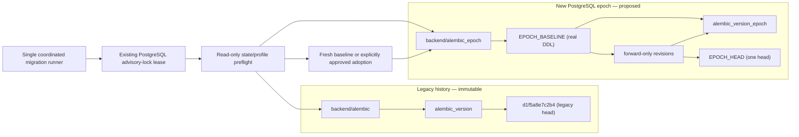

# Phase 3.2J — New Migration Epoch Architecture Design

**Status: DESIGN ONLY — NOT IMPLEMENTED OR ACTIVATED**

- **Legacy Alembic head:** `d1f5a8e7c2b4`
- **Legacy root:** `dd495117949b`
- **PostgreSQL tested:** 18.6 on a disposable loopback cluster
- **Production / Neon access:** None
- **Migration execution, stamp, deployment, commit, or push:** None

## Decision

Use the already-separated epoch scaffold for a new, forward-only PostgreSQL
migration lineage. Do not repair, rebase, or replay the legacy graph for fresh
installations. Preserve its revisions and any existing `alembic_version` row as
historical evidence.

The epoch is not yet a supported migration path. Its directory has no
revisions, its environment rejects PostgreSQL, and the application migration
runner still rejects PostgreSQL migrations. The current legacy runner also
contains a `create_all()`/`stamp()` bootstrap path; it is not a valid baseline
and must not be used by the epoch or treated as migration replay.

Adoption of an existing database is a separate, profile-gated route. No
operator-approved historical profile is known, so adoption is **BLOCKED**.
The architecture below does not assert that any legacy revision identifies a
specific live schema.

## Findings and architecture inventory

| Surface | Observed state | Design consequence |
|---|---|---|
| Legacy Alembic graph | `backend/alembic` has one head, `d1f5a8e7c2b4`, and historical root `dd495117949b`. The root is not a safe fresh baseline. | Preserve the graph; never make the epoch descend from it. |
| Legacy migration runner | `backend/run_migrations.py` owns current dispatch and acquires the PostgreSQL advisory lock through the existing coordinator, but `require_supported_migration_dialect()` rejects PostgreSQL. It contains an empty-PostgreSQL `create_all()` plus `stamp()` bootstrap. | Keep PostgreSQL blocked. Later replace the bootstrap with an explicit epoch route; do not make a parallel runner that can bypass the shared owner. |
| Epoch script directory | `backend/alembic_epoch` exists, has no revisions, and is guarded as inactive. `backend/alembic_epoch/env.py` requires an explicit scaffold flag, then rejects PostgreSQL and checks SQLite ownership. | Reuse this location only after review; remove the scaffold-only activation path as part of a separately approved implementation. |
| Epoch config | `backend/alembic_epoch.ini` selects `backend/alembic_epoch` and `version_table = alembic_version_epoch`. | Keep this distinct version table; ensure all epoch work is dispatched through the coordinated runner. |
| Epoch state helper | `epoch_state.py` names `qubira_epoch_control`, `qubira_epoch_audit`, and `alembic_version_epoch`; it classifies partial control-object states and blocks the legacy runner when epoch objects exist. | These names are a useful guard contract, not proof that a complete gate, audit schema, or state machine has been implemented. |
| PostgreSQL ownership | The existing coordinator uses a dedicated `NullPool` connection and session advisory lock. Its lease records the SQLAlchemy connection, database identity, and backend PID. Prior disposable PostgreSQL tests covered lock exclusion, connection identity, release, and termination. | Preserve the same lock namespace/key and lease. Both lineages must inspect and migrate on that exact owned connection. Cross-lineage contention remains to be tested. |
| Schema inventory | `schema_manifest.py` inventories tables, columns, PK/FK/unique/check constraints, indexes, views, materialized views, triggers, sequences, and PostgreSQL extensions. It does not cover every PostgreSQL object class. | Extend and review inventory coverage before claiming complete unknown-object detection or adopting a database. |
| Readiness | Current readiness preflight checks the legacy script graph/version state and compares against SQLAlchemy metadata. It has no epoch-state contract. | Add an explicit, fail-closed epoch readiness mode before transition; never interpret an epoch-only fresh database as a broken or completed legacy history. |
| Model inventory | `backend/app/models/__init__.py` imports the mapped application models, including audit and interview models outside that directory. | Baseline scope must be derived by reviewing every registered mapped class and every migration-only object, not by using current metadata to emit DDL. |
| Historical evidence | Phase 3.2I found no approved schema snapshot/profile; current model metadata is not evidence of a historical production schema. | No starting revision is currently eligible for adoption. Do not infer one. |

Phase 3.1 reports are design evidence only. Where older reports name a
different legacy head, Phase 3.2I is the newer graph observation for this
design. No report establishes a supported existing PostgreSQL schema.

## Recommended topology

`EPOCH_BASELINE` and `EPOCH_HEAD` are design labels, not assigned revision IDs.
The initial implementation must generate and review real revision identifiers.
The epoch graph must have exactly one head and all later revisions must descend
from its baseline. There must be no `down_revision` or `depends_on` edge into
the legacy graph. Do not create a merge revision between the two histories.

### Version-table semantics

| Database path | `alembic_version` (legacy) | `alembic_version_epoch` (epoch) |
|---|---|---|
| Fresh epoch install | Absent. The database did not execute the legacy migrations. | Created/advanced by Alembic only as the real epoch revisions execute. |
| Approved adoption | Preserved unchanged with the exact source revision observed. It remains provenance, not the active migration target. | Created/advanced only after the profile-specific adoption work, checks, and epoch migration succeed. |
| Verified epoch database | Preserved if it existed at adoption; absent for a fresh epoch database. | Exactly one row at the independently verified epoch head. |
| Unknown, partial, or failed transition | Never rewritten to make the database appear compatible. | Missing, multiple, unknown, or unexpected rows block migration and readiness. |

The epoch version table is authoritative after a verified transition. The
legacy version row is never advanced to an epoch revision and is never
described as having completed the legacy history on a fresh install.

## Migration state and transition rules

```mermaid
stateDiagram-v2
    [*] --> Unclassified
    Unclassified --> FreshPreflight: no application objects or revision state
    Unclassified --> AdoptionPreflight: exact legacy revision plus reviewed profile
    Unclassified --> Refused: unknown / mixed / partial state
    FreshPreflight --> Started: empty-schema checks pass; durable intent recorded
    AdoptionPreflight --> Started: manifest, invariants, and one-use authorization pass
    Started --> Applying: epoch baseline executes on owned connection
    Applying --> CommittedUnverified: DDL and epoch revision transaction committed
    CommittedUnverified --> Verified: independent target/schema/data checks pass
    Started --> RecoveryRequired: exception or uncertain outcome
    Applying --> RecoveryRequired: failure, crash, or connection loss
    CommittedUnverified --> RecoveryRequired: final verification fails or is interrupted
    RecoveryRequired --> Verified: reviewed evidence proves the committed target is valid
    RecoveryRequired --> Applying: only after explicit inspection and new authorization
    Refused --> [*]
```

The transition state is durable and separate from the Alembic version row. The
proposed control tables are `qubira_epoch_control` and `qubira_epoch_audit`.
Their DDL and exact schema remain to be designed and reviewed.

1. Acquire the existing migration lock before reading any state. Use its
   dedicated connection for identity checks, preflight, Alembic, and final
   verification.
2. Read-only classify the database. A fresh install requires no application
   objects, no legacy or epoch version state, and no unexplained schema objects.
   Adoption requires a reviewed profile and exact source revision. Partial
   control state, unrecognized extras, mixed history, or any mismatch refuses.
3. Before application DDL, commit a durable `started` transition record under
   the lock. The only pre-baseline DDL permitted is the reviewed epoch control
   and audit infrastructure. It must not alter application objects.
4. Recheck the source fingerprint and revision under the lock. Run the
   profile-selected baseline plan using the same physical connection. Alembic
   records the epoch revision only after the migration body succeeds. No
   `stamp`, `create_all()`, or direct version-table insert is allowed.
5. Validate the complete target inventory and data invariants. Mark the
   transition `verified` only after the revision, audit, schema fingerprint,
   and data checks agree. The application remains unready before then.
6. On error or uncertain connection outcome, leave the durable state at
   `started` or mark it `recovery_required` if the owned connection can safely
   do so. Never retry automatically after transition intent or DDL. The next
   process acquires the lock, observes the state, and refuses normal migration
   until recovery is explicitly authorized.

The common baseline revision may have a `fresh_create` route and named,
reviewed `adopt_<profile>` routes. The route is selected by the runner only
after exact profile, database identity, source revision, and source fingerprint
checks; the migration must revalidate those facts on the owned connection.
Every route must produce the same target contract and independently pass
verification. Route-specific operations and verified-existing objects are
recorded in an append-only audit with a plan digest. A route may not imply that
the old history ran or that an existing table was created by the baseline.

## Fresh PostgreSQL baseline scope

The baseline must be a genuine, reviewed Alembic revision that creates the
application schema through explicit versioned DDL. It must not call
`Base.metadata.create_all()`, `MigrationContext.stamp()`, or use an empty/no-op
revision to mark existing objects as complete. SQLAlchemy metadata is a
comparison input, not a runtime DDL generator or proof of historical state.

Before implementation, produce a reviewed table/object inventory from all
registered SQLAlchemy models in `backend/app/models/__init__.py` and related
model modules, plus objects introduced only by historical migration code or
application SQL. At minimum, the schema contract and baseline review must
cover:

- Every mapped table, column, association table, SQL type, length, precision,
  scale, nullability, identity/autoincrement behavior, generated/computed
  columns, and server defaults.
- Primary keys; foreign keys with target schema/columns and `ON DELETE` and
  `ON UPDATE` actions; unique and check constraints; indexes, including
  expressions, partial predicates, included columns, ordering, and uniqueness.
- Sequences and ownership; enums, domains, and other custom types; JSON/JSONB
  semantics; extensions and versions that affect application behavior.
- Views, materialized views, triggers, and trigger functions wherever required
  by the reviewed application contract.
- Required schema names, search-path assumptions, and grants/privileges for
  the application and migration roles.
- Epoch control and audit objects, created under their separately reviewed
  contract. Alembic creates and updates `alembic_version_epoch` as part of
  executing the revision.

The migration inventory must be checked against the complete PostgreSQL
catalog inventory, not just model metadata or the current manifest helper.
At present, that helper does not enumerate every relevant object category,
including all routines, policies, custom types, grants, ownership, partitions,
and cross-schema dependencies. Its gaps must be closed or explicitly
accounted for before a claim that unknown schema objects are detected.

Fresh installation fails closed if the target application schema is not empty
or contains an unapproved object. It does not drop, replace, or adopt an
unexplained object. An already-present extension or equivalent object is
accepted only if its version and full semantic definition match an explicit
baseline precondition; otherwise stop. The baseline's dialect/server support
must be explicit. PostgreSQL 18.6 loopback is the currently tested environment;
other PostgreSQL versions and SQLite are not certified by this design.

All epoch revisions are forward-only. Later revisions use expand/contract
changes and explicit data-preservation validation. Downgrade execution is not
an operational recovery plan; downgrade commands must be blocked by the
coordinated runner and migration scripts must fail explicitly rather than
silently performing an incomplete rollback.

## Existing database adoption procedure

Adoption is a separately authorized operation, not a side effect of `upgrade
head`. It remains **BLOCKED** until an operator provides a real, sanitized,
reviewed source profile. No profile is inferred from `d1f5a8e7c2b4`, model
metadata, a prior report, or a revision filename.

### Required profile and authorization

The profile must include:

- A stable profile ID, evidence/change-ticket ID, exact supported database
  engine/server range, schema name, and a single exact legacy
  `alembic_version.version_num` captured from a reviewed schema-only snapshot.
- A complete canonical source manifest and digest; a separately reviewed
  target manifest and digest; the manifest format/version and comparator rules.
- Exact allowed differences and migration operations. Unknown extra objects,
  missing objects, conflicts, ambiguous type conversions, and destructive or
  unverified transforms are not tolerated by default.
- Synthetic-only fixtures and expected preservation assertions for users,
  profiles, roles, XP ledger/totals/levels, achievements/streaks, battles,
  participants/results, questions/submissions, and placement companies,
  tracks, rounds, and assessments.
- A one-use authorization bound to the target database identity, starting
  revision, source/target/profile digests, migration bundle/plan digest,
  operator/change identity, and expiry. It contains no credentials or user
  data. This phase did not connect to Neon or production to obtain any profile.

### Execution contract

1. Acquire the shared migration ownership lease; confirm database identity and
   backend PID on the lease connection.
2. Read the legacy version row and full catalog/data preflight on that
   connection. Require exactly one revision equal to the profile's supported
   start revision; compare the complete live source inventory and fingerprint
   to the profile. Recheck authorization and source fingerprint immediately
   before DDL.
3. Capture before-state evidence: object inventories and definitions, table
   counts, primary keys, foreign keys, indexes/constraints, and deterministic
   checksums for synthetic representative records. Do not log PII, credentials,
   or raw records.
4. Execute only the reviewed profile's operations. Preserve the legacy
   `alembic_version` table and user identifiers. Never rewrite historical
   migrations or use `stamp` to conceal missing history. Missing expected
   migration history is not repaired by adoption.
5. Verify target inventory and all preservation assertions: record counts,
   identifiers, roles, XP/levels, relationships, battles, results, placement
   records, foreign-key integrity, and critical indexes. Compare every
   difference to the pre-approved operation plan. Unknown difference fails
   closed.
6. Record the actual route, source/target fingerprints, operation-plan digest,
   results, and epoch revision in the epoch audit. Only then mark the epoch
   state `verified` and expose the epoch head to readiness.

If the source already matches the target, adoption still executes a versioned
verification/audit transition and creates the epoch control state. It records
no fictional DDL. A fresh-install baseline must not be falsely represented as
having created existing application objects; the audit records them as
verified-existing for that named profile.

**Current supported adoption profiles: none.** An operator-approved profile,
target manifest, and preservation fixture are required before implementation
can safely enable an adoption route.

## Shared ownership, legacy coexistence, and runner rules

There must be one migration ownership system, not one lock per Alembic
directory:

- Keep the existing PostgreSQL advisory-lock namespace/key, ownership lease,
  dedicated `NullPool` connection, database-identity check, and backend-PID
  verification. Do not create a new epoch lock, lock table, or separate
  connection.
- Evolve the coordinated runner as the sole entry point. It chooses the
  legacy or epoch `ScriptDirectory` only after acquiring the shared lock and
  classifying state. Legacy and epoch migration inspection, preflight,
  execution, and final verification use the exact same `Connection` and
  backend session holding that lock.
- Guard legacy and epoch paths symmetrically. If any epoch control/version
  object exists, the legacy runner refuses. If a valid legacy state or
  adoption transition exists, an epoch fresh-install path refuses. Partial,
  malformed, or ambiguous state is a hard error, never a fallback to the
  other lineage.
- The source of truth for the active epoch is its version table plus a
  verified durable transition record and target fingerprint. The presence of
  an epoch version table alone is insufficient. A mixed legacy+epoch state is
  valid only for a complete, verified adoption record matching both manifests.
- Direct Alembic CLI execution must not open another database connection or
  bypass the owner. The epoch environment must require the owner lease just as
  the legacy environment does; reject offline/external execution paths that
  cannot enforce the gate. Remove the scaffold env-var escape hatch only in a
  separately reviewed implementation that routes all execution through the
  shared coordinator.
- PostgreSQL remains rejected by the production migration runner until
  disposable fresh-install, adoption, ownership, failure, and recovery gates
  pass. No changes to that gate are part of this design phase.

The current helper `assert_legacy_runner_allowed()` already refuses observed
epoch control objects, and the legacy migration path invokes it while holding
ownership. Before activation, verify that it checks full control/audit state
and transition status—not merely table-name presence—and that every supported
legacy executable is guarded. Prevent unguarded old application/job images
from running during any future transition.

## API readiness contract

Readiness is read-only and does not migrate, repair, stamp, or create schema.
The application selects a known migration mode from explicit release
configuration and durable state; it must never infer that absent legacy
metadata means the schema is current.

| Mode | Required ready conditions |
|---|---|
| Pre-epoch legacy operation | The legacy graph has one expected head; legacy revision and legacy schema checks pass. No epoch object or transition is present. |
| Epoch operation | Epoch script directory has exactly one head; `alembic_version_epoch` has exactly one row at that head; control/audit state is complete and `verified`; target fingerprint and required integrity checks match. |
| Fresh epoch database | Epoch conditions pass without requiring `alembic_version`. Its absence truthfully reflects that legacy migrations were never run. |
| Adoption / transition in progress | Not ready. `started`, `committed_unverified`, `recovery_required`, malformed or partial controls, unknown revisions, multiple version rows, fingerprint mismatch, or failed invariants return a specific degraded/not-ready status. |
| Unknown or mixed state | Not ready and no mutation. Do not fall back from epoch checks to the legacy readiness path or return success based on connectivity alone. |

`/health` remains liveness-only. `/ready` reports schema and transition
compatibility accurately and performs only read-only inspection. The current
readiness implementation is legacy-oriented; epoch-aware readiness must be
implemented and tested before any epoch transition. For a schema mismatch,
readiness reports failure without attempting repair.

## Recovery and failure policy

| Failure point | Required behavior |
|---|---|
| Before durable `started` intent | Refuse without application-schema DDL. A bounded lock acquisition failure can be retried only before intent. |
| After `started`, before DDL | Persist or retain a blocked/recovery state. Do not infer that the operation is safe to retry solely because no revision row is visible. Inspect under the lock and require explicit authorization. |
| During DDL or data operation | Roll back only if the database/driver proves the transaction was rolled back. Otherwise leave `started`/`recovery_required`; never auto-retry. |
| Connection loss or process termination | PostgreSQL releases the session advisory lock when the session ends. The durable transition marker remains; the next owner refuses normal migration and performs read-only diagnosis. |
| DDL/revision committed, final verification interrupted | Mark or retain `committed_unverified`; block API readiness and all normal migration paths until schema and data are independently verified. |
| Verified transition, application rollout failure | Do not invoke the legacy runner. Application rollback is permitted only after compatibility was proven; otherwise keep traffic disabled and use a separately reviewed forward fix or backup-restore plan. |

Recovery requires a fresh read-only capture of version rows, the complete
catalog manifest, audit/control state, and preservation checks. After review,
an operator may authorize one forward repair revision or a verified restore
and reconciliation plan. Do not run Alembic downgrade, delete/recreate tables,
rewrite legacy version rows, stamp, or retry automatically. A backup restore
must account for writes after the backup and be validated separately before
any endpoint cutover.

## PostgreSQL 18.6 test matrix

All migration tests must use the existing loopback-only
`backend/scripts/test-postgresql18.ps1` environment or an equivalently isolated
disposable PostgreSQL 18.6 instance. Verify database identity before any DDL.
Use synthetic records and a unique disposable database; never silently
substitute SQLite. These are required tests, **not results**:

| Scenario | Required proof | Current status |
|---|---|---|
| Fresh epoch installation | Empty disposable database; real epoch DDL; complete catalog and model-compatibility check; one epoch head/version row; no legacy version row. | NOT TESTED |
| Repeated current-head verification | Rerun read-only state and manifest checks; no DDL, no second revision row, same fingerprint. | NOT TESTED |
| Existing-schema adoption | Only an operator-reviewed profile; execute actual Alembic path; compare full before/after catalog, record IDs/counts/checksums, FK integrity, XP/levels, battles, questions, and placement. | BLOCKED — no approved profile |
| Unknown schema and revision | Add an unapproved object or unknown revision to the disposable fixture; prove refusal before application DDL and preservation of the object/data. | NOT TESTED |
| Incompatible/missing/conflicting objects | Missing required table/index, wrong column type/default, conflicting FK/index, invalid FK data; prove fail-closed and unchanged source state. | NOT TESTED |
| Legacy version handling | Fresh route does not create/claim `alembic_version`; adoption preserves its exact row; malformed/multiple rows refuse. | NOT TESTED |
| Epoch version handling | Alembic creates the distinct epoch table during execution; unknown, multiple, missing, or non-head rows fail readiness and migration. | NOT TESTED |
| Concurrent legacy/epoch attempts | Separate processes target the same disposable database; one obtains the existing advisory lock and the other is refused; assert same backend PID/connection across preflight, Alembic, and final checks. | NOT TESTED across paths |
| Failure and recovery | Inject transactional DDL failure, partial/non-transactional operation, final-verification failure, and connection loss; prove no automatic retry/stamp and durable gate behavior. | NOT TESTED |
| Process termination | Kill only a disposable lock-holding migration process; verify PostgreSQL releases session lock and next runner sees durable recovery state. | Prior lock-release test passed; epoch state scenario NOT TESTED |
| Data preservation | Synthetic source data assertions include user/profile IDs and roles, XP ledger/totals/levels, achievements/streaks, battle graph, question/submission records, placement records, FKs, and critical indexes. | NOT TESTED |
| Readiness | Verify `/health`, `/ready`, and representative application routes; unknown/in-progress/incompatible epoch state returns failure without schema mutation. | Existing API-only probes passed on incomplete synthetic schema; epoch readiness NOT TESTED |
| Build and application persistence | Build current release and run focused PostgreSQL persistence/integration checks against the verified epoch schema. | NOT TESTED for epoch |

Before reporting a successful migration, run the epoch `heads` and verbose
history commands, execute the actual Alembic baseline on a fresh disposable
PostgreSQL database, and replay every approved adoption profile from its
schema-faithful start. Fresh model bootstrap tests do not substitute for either
replay. Activation requires all mandatory scenarios to pass, report artifacts
to record exact commands/results, and independent review.

## Unresolved operator and engineering requirements

1. Supply a sanitized, reviewed historical PostgreSQL schema-only manifest,
   exact source Alembic revision, engine/version context, and synthetic
   preservation fixture for each intended adoption profile. No such profile
   is currently approved.
2. Supply a separately reviewed canonical target manifest. Current models and
   the existing partial manifest helper alone are insufficient.
3. Complete the PostgreSQL catalog inventory and canonicalization policy for
   custom types, routines, policies, grants/ownership, partitions, extension
   versions, and cross-schema dependencies.
4. Review the full mapped-model and migration-only object inventory and hand
   review generated/proposed baseline DDL. Confirm extension and role
   provisioning policy for the target PostgreSQL deployment.
5. Define control/audit table schema, state transitions, retention, redacted
   diagnostics, and one-use operator authorization format.
6. Integrate both lineages into one shared coordinated runner and prove
   lock/connection identity across both paths. Preserve the activation gate
   until failure, restart, and ownership tests pass.
7. Implement explicit epoch readiness and release-mode selection without
   migration side effects. Prove old runners cannot bypass the epoch guard.
8. Complete fresh PostgreSQL 18.6 DDL replay, profile-based adoption replay,
   preservation checks, failure/recovery tests, readiness tests, and
   application persistence/build checks.

## Phase decision

**Architecture recommendation: a separate forward-only epoch is the safest
candidate for fresh PostgreSQL installations, provided all implementation and
acceptance gates above pass.** It avoids replaying the unsafe legacy root and
keeps legacy history intact. It does not, by itself, prove that any existing
database can be adopted safely.

**Activation gate: CLOSED.** This document authorizes no migration, stamp,
production access, deployment, or change to the PostgreSQL execution gate.
Fresh-install compatibility, existing-database compatibility, cross-lineage
lock behavior, and epoch readiness remain unproven until the required
disposable PostgreSQL DDL and data-preservation tests actually run.
